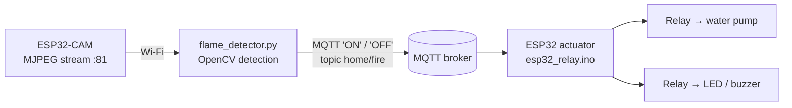

# 🔥 IoT Fire Detection & Extinguisher System

Real-time fire detection on an **ESP32-CAM** video stream with **computer vision (OpenCV)**, and automatic activation of a **water pump and alarm** by a second **ESP32** over **MQTT**.

<p align="center">
  
</p>

🎥 Full demo video: [`demo/demo.mp4`](demo/demo.mp4)

---

## How it works



1. **Capture** – the ESP32-CAM streams video over Wi-Fi (`http://<ip>:81/stream`).
2. **Detect** – `flame_detector.py` analyses every frame on a PC.
3. **Confirm** – fire must be seen on several consecutive frames before the alarm is raised.
4. **Act** – the PC publishes `ON` on the MQTT topic `home/fire`; the ESP32 switches the pump and the alarm relays. `OFF` is sent once the fire is gone.

### Detection pipeline

Fire is detected with classic computer vision, without a neural network, so it runs in real time on a normal laptop:

| Step | What it does | Why |
|---|---|---|
| HSV color segmentation | Three flame color profiles: *white-hot*, *bright core*, *dancing tip* | Flames have a specific hue / brightness range |
| Morphological opening | Removes small noise | Fewer false detections |
| Background subtraction (MOG2) | Keeps only regions that change | A static orange object is not a fire |
| Shape analysis | Rejects round blobs (low circularity required) | Lamps and LEDs are round, flames are irregular |
| Flicker score | Pixel change in the region over the last frames | Real flames flicker |
| Temporal confirmation | N consecutive fire frames (default 5) | Avoids alarms on a single bad frame |

### Safety on the actuator side
- Relays start **OFF** at boot.
- **Auto-off after 60 s** if no new `ON` message arrives (the PC refreshes `ON` every 10 s while fire is visible). If the PC or the network fails, the pump does not stay on forever.
- Automatic Wi-Fi / MQTT reconnection on both sides.

## Hardware

| Component | Role |
|---|---|
| ESP32-CAM (AI Thinker) | Video capture and Wi-Fi streaming |
| ESP32 DevKit | Actuator controller (MQTT subscriber) |
| 2-channel relay module (active LOW) | Switches the pump and the alarm |
| Mini water pump + external power supply | Fire suppression |
| LED / buzzer | Local alarm |

### Wiring (actuator ESP32)

| ESP32 pin | Connected to |
|---|---|
| GPIO 13 | Relay IN1 → water pump |
| GPIO 12 | Relay IN2 → LED / buzzer |
| 5V / GND | Relay module power |

> ⚠️ Power the pump from an external supply, not from the ESP32.

## Getting started

### 1. ESP32-CAM
Flash the **CameraWebServer** example from the ESP32 Arduino core (board: *AI Thinker ESP32-CAM*), set your Wi-Fi, and note the IP printed on the serial monitor. The stream is available at `http://<ESP32-CAM-IP>:81/stream`.

### 2. MQTT broker
Run any MQTT broker on the PC or the local network, for example [Mosquitto](https://mosquitto.org/):
```bash
mosquitto -v
```

### 3. Actuator ESP32
Open `esp32_relay.ino` in the Arduino IDE, install the **PubSubClient** library, set `ssid`, `password` and `mqtt_server`, then upload (board: *ESP32 Dev Module*).

### 4. Detection on the PC
```bash
git clone https://github.com/yosrarhim/IoT-AI-Fire-Extinguisher-System.git
cd IoT-AI-Fire-Extinguisher-System
pip install -r requirements.txt

python flame_detector.py --stream http://<ESP32-CAM-IP>:81/stream --broker <BROKER-IP>
```

Useful options:

| Option | Default | Description |
|---|---|---|
| `--stream` | `http://192.168.137.57:81/stream` | Stream URL, or `0` to test with the PC webcam |
| `--broker` | none | MQTT broker IP (without it, detection runs without sending commands) |
| `--topic` | `home/fire` | Must match `topic_sub` in `esp32_relay.ino` |
| `--confirm-frames` | `5` | Consecutive fire frames before the alarm |
| `--clear-seconds` | `5` | Seconds without fire before `OFF` |
| `--headless` | off | No display windows |

Press `q` to quit.

## Repository structure
```
├── flame_detector.py   # Fire detection (OpenCV) + MQTT alarm publisher
├── esp32_relay.ino     # Actuator ESP32: MQTT subscriber, pump + alarm relays
├── requirements.txt
├── demo/demo.mp4       # Full demo video
└── docs/demo.gif
```

## Challenges and lessons learned

- **ESP32-CAM limits.** The ESP32-CAM does not have the memory or compute to run image analysis at a useful frame rate, so it only streams video and the analysis runs on a PC.
- **False positives.** Color alone triggers on red or orange objects, lamps and reflections. Background subtraction, shape and flicker analysis, plus confirmation over several frames, reduce them a lot.
- **Unstable stream.** The ESP32-CAM stream drops regularly, so the detector reconnects automatically and uses a 1-frame buffer to stay real time.
- **Fail-safe actuation.** The pump must never stay on if the PC crashes, hence the 60 s auto-off on the ESP32.

## Future work

- Run a small quantized neural network (e.g. TensorFlow Lite Micro / Edge Impulse on an ESP32-S3) to detect fire directly on the camera board, without the PC.
- Add flame and temperature sensors on the actuator board to confirm fire locally.
- Dashboard and mobile notifications.

## Tech stack

`Python` · `OpenCV` · `NumPy` · `MQTT (paho-mqtt, PubSubClient)` · `C/C++ (Arduino)` · `ESP32` · `ESP32-CAM` · `Wi-Fi`

## Author

**Yosra Rhim** – Embedded Systems & AI Engineer · [LinkedIn](https://www.linkedin.com/in/yosrarrhim) · [GitHub](https://github.com/yosrarhim)
