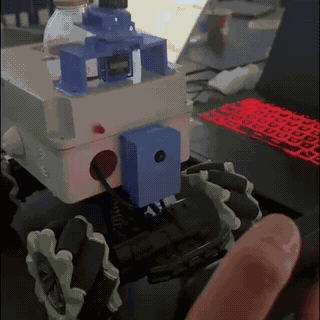
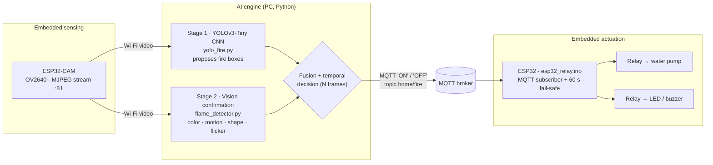

# 🔥 IoT-AI Fire Extinguisher System — Embedded Systems × AI (YOLOv3-Tiny)

An **AIoT** project that joins **embedded systems** and **artificial intelligence** in one loop: an **ESP32-CAM** sees, a **two-stage AI engine** (**YOLOv3-Tiny** CNN + computer-vision confirmation) decides, and an **ESP32 actuator** acts by starting a water pump and an alarm over **MQTT**, in real time.

<p align="center">
  
</p>

🎥 Full demo video: [`demo/demo.mp4`](demo/demo.mp4)

---

## Embedded × AI at a glance

| | Embedded side | Intelligence side |
|---|---|---|
| **Sense** | ESP32-CAM captures and streams video over Wi-Fi | Frames feed the vision engine in real time |
| **Decide** | Embedded constraints (RAM, CPU, Wi-Fi) shape the architecture | YOLOv3-Tiny CNN detects fire, vision analysis confirms it (color, motion, shape, flicker, time) |
| **Act** | ESP32 drives relays → pump and alarm, with hardware fail-safe | The vision decision becomes an MQTT command to the hardware |

## Project architecture



1. **Embedded capture** – the ESP32-CAM streams video over Wi-Fi (`http://<ip>:81/stream`).
2. **AI detection, stage 1** – **YOLOv3-Tiny** (`yolo_fire.py`), a lightweight CNN object detector, proposes fire bounding boxes on each frame.
3. **AI detection, stage 2** – the vision pipeline (`flame_detector.py`) checks that each box contains a real, moving, flickering flame and not a red object or a lamp.
4. **Smart decision** – a box is accepted when both stages agree (or when YOLO is very confident), and fire must be seen on several consecutive frames, so the hardware is only triggered by a stable decision.
5. **Embedded action** – the decision is published as `ON` on the MQTT topic `home/fire`; the ESP32 switches the pump and alarm relays, then `OFF` once the fire is gone.

### Stage 1 – YOLOv3-Tiny, a CNN sized for real time

| | |
|---|---|
| Model | YOLOv3-Tiny, 1 class (`fire`) – [`models/yolov3-tiny-fire.cfg`](models/yolov3-tiny-fire.cfg) |
| Network | 13 convolutional layers, 2 detection heads (13×13 and 26×26 grids), ~8.7 M parameters |
| Input | 416 × 416 RGB, from the ESP32-CAM stream |
| Inference | OpenCV DNN on CPU, no deep-learning framework needed at run time |
| Training | Darknet on GPU, transfer learning from YOLOv3-Tiny – [Colab notebook](notebooks/train_yolov3_tiny_fire.ipynb) · [`docs/TRAINING.md`](docs/TRAINING.md) |

Train the model in one click: [](https://colab.research.google.com/github/yosrarhim/IoT-AI-Fire-Extinguisher-System/blob/main/notebooks/train_yolov3_tiny_fire.ipynb)

YOLOv3-Tiny was chosen over full YOLOv3 because the system must react in real time on a laptop CPU from a low-resolution embedded camera: the Tiny version keeps the speed while still localizing the flame in the image.

### Stage 2 – Vision confirmation, designed for an embedded camera

The confirmation stage reasons on several visual features of fire, and each step was chosen to cope with the noisy, low-resolution images of a microcontroller camera:

| Step | What the intelligence does | Embedded reason |
|---|---|---|
| HSV color segmentation | Three tuned flame color profiles: *white-hot*, *bright core*, *dancing tip* | Robust to the ESP32-CAM's auto-exposure and color shifts |
| Morphological filtering | Removes small noise | ESP32-CAM JPEG compression creates artifacts |
| Background subtraction (MOG2) | Keeps only regions that change | A static orange object near the robot is not a fire |
| Shape analysis | Rejects round blobs (low circularity required) | Ignores the robot's own LEDs and lamps |
| Flicker score | Measures pixel change over the last frames | Real flames flicker, reflections do not |
| Temporal decision | N consecutive fire frames (default 5) | Protects the pump from a single bad Wi-Fi frame |

### Fail-safe embedded actuation

The AI decides, but the embedded firmware keeps control of safety:
- Relays start **OFF** at boot.
- **Auto-off after 60 s** if no new `ON` decision arrives (the vision engine refreshes `ON` every 10 s while fire is visible). If the PC or the network fails, the pump never stays on.
- Automatic Wi-Fi / MQTT reconnection on both the vision side and the embedded side.

## Embedded hardware

| Component | Role in the AIoT loop |
|---|---|
| ESP32-CAM (AI Thinker) | Embedded vision sensor: captures and streams the images the AI analyses |
| ESP32 DevKit | Embedded brain of the actuator: turns AI decisions into physical action |
| 2-channel relay module (active LOW) | Switches the pump and the alarm |
| Mini water pump + external power supply | Fire suppression |
| LED / buzzer | Local alarm when the AI confirms fire |

### Wiring (actuator ESP32)

| ESP32 pin | Connected to |
|---|---|
| GPIO 13 | Relay IN1 → water pump |
| GPIO 12 | Relay IN2 → LED / buzzer |
| 5V / GND | Relay module power |

> ⚠️ Power the pump from an external supply, not from the ESP32.

## Getting started

### 1. Embedded camera (ESP32-CAM)
Flash the **CameraWebServer** example from the ESP32 Arduino core (board: *AI Thinker ESP32-CAM*), set your Wi-Fi, and note the IP printed on the serial monitor. The stream for the vision engine is at `http://<ESP32-CAM-IP>:81/stream`.

### 2. MQTT broker (link between AI and hardware)
Run any MQTT broker on the PC or the local network, for example [Mosquitto](https://mosquitto.org/):
```bash
mosquitto -v
```

### 3. Embedded actuator (ESP32)
Open `esp32_relay.ino` in the Arduino IDE, install the **PubSubClient** library, set `ssid`, `password` and `mqtt_server`, then upload (board: *ESP32 Dev Module*).

### 4. Intelligent detection engine
```bash
git clone https://github.com/yosrarhim/IoT-AI-Fire-Extinguisher-System.git
cd IoT-AI-Fire-Extinguisher-System
pip install -r requirements.txt

python flame_detector.py --stream http://<ESP32-CAM-IP>:81/stream --broker <BROKER-IP> \
    --yolo-weights models/yolov3-tiny-fire.weights
```

The trained weights file is not stored in the repository (size): train it with [`docs/TRAINING.md`](docs/TRAINING.md). Without `--yolo-weights`, the system runs with the vision stage only.

Useful options:

| Option | Default | Description |
|---|---|---|
| `--stream` | `http://192.168.137.57:81/stream` | Embedded camera stream URL, or `0` to test with the PC webcam |
| `--broker` | none | MQTT broker IP (without it, the AI detects but does not command the hardware) |
| `--topic` | `home/fire` | Must match `topic_sub` in `esp32_relay.ino` |
| `--confirm-frames` | `5` | Consecutive fire frames before the hardware is triggered |
| `--clear-seconds` | `5` | Seconds without fire before `OFF` |
| `--headless` | off | No display windows |
| `--yolo-weights` | none | Trained YOLOv3-Tiny weights (enables the AI stage 1) |
| `--mode` | `hybrid` with weights, `vision` without | `hybrid` = YOLO + confirmation, `yolo` = YOLO only, `vision` = stage 2 only |
| `--yolo-conf` / `--yolo-high-conf` | `0.4` / `0.8` | YOLO threshold, and confidence above which YOLO alone triggers the alarm |

Press `q` to quit.

## Repository structure
```
├── flame_detector.py           # AI engine: vision confirmation, fusion, decisions over MQTT
├── yolo_fire.py                # AI stage 1: YOLOv3-Tiny fire detector (OpenCV DNN)
├── models/
│   ├── yolov3-tiny-fire.cfg    # 1-class YOLOv3-Tiny network
│   ├── fire.names
│   └── fire.data               # Darknet training config
├── esp32_relay.ino             # Embedded: ESP32 actuator firmware, pump + alarm relays, fail-safe
├── docs/TRAINING.md            # How to train the YOLOv3-Tiny fire model
├── notebooks/train_yolov3_tiny_fire.ipynb  # Colab: train + evaluate YOLOv3-Tiny (mAP)
├── requirements.txt
├── demo/demo.mp4       # Full demo of the AI + embedded loop
└── docs/demo.gif
```

## Challenges and lessons learned at the Embedded × AI boundary

- **Where should the intelligence run?** The ESP32-CAM does not have the memory or compute to analyse images at a useful frame rate. The architecture splits the work: the embedded camera captures, the vision engine decides, the embedded actuator acts.
- **Making AI reliable on embedded images.** A single detector, CNN or color-based, triggers on red objects, LEDs and reflections in low-quality camera frames. Fusing YOLOv3-Tiny with motion, shape and flicker analysis, plus temporal confirmation, makes the decision robust enough to drive real hardware.
- **Unstable embedded stream.** The ESP32-CAM stream drops regularly, so the vision engine reconnects automatically and keeps a 1-frame buffer to stay real time.
- **Safety first when AI controls hardware.** A detection error or a PC crash must never leave the pump on: hence the 60 s fail-safe in the ESP32 firmware.

## Next step: Edge AI

- Quantize a fire detection model (int8) and run it **directly on the microcontroller** (TensorFlow Lite Micro / Edge Impulse on an ESP32-S3), so the embedded board detects fire itself without the PC.
- Fuse vision with embedded **flame and temperature sensors** for multi-sensor AI decisions.
- Dashboard and mobile notifications.

## Tech stack

**Embedded:** `ESP32` · `ESP32-CAM` · `C/C++ (Arduino)` · `PubSubClient` · `Relays` · `Wi-Fi`
**AI:** `YOLOv3-Tiny` · `CNN` · `Darknet` · `OpenCV DNN` · `Python` · `NumPy` · `Computer vision`
**Connectivity:** `MQTT` · `paho-mqtt`

## Author

**Yosra Rhim** – Embedded Systems & AI Engineer · [LinkedIn](https://www.linkedin.com/in/rhim-yosra-135a51251) · [GitHub](https://github.com/yosrarhim)
